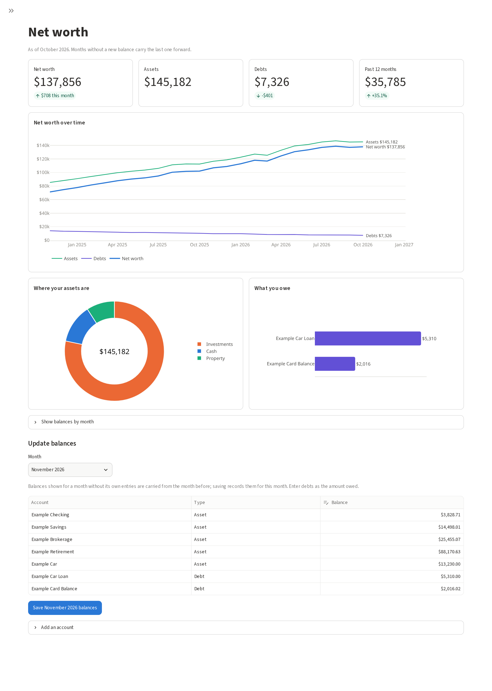
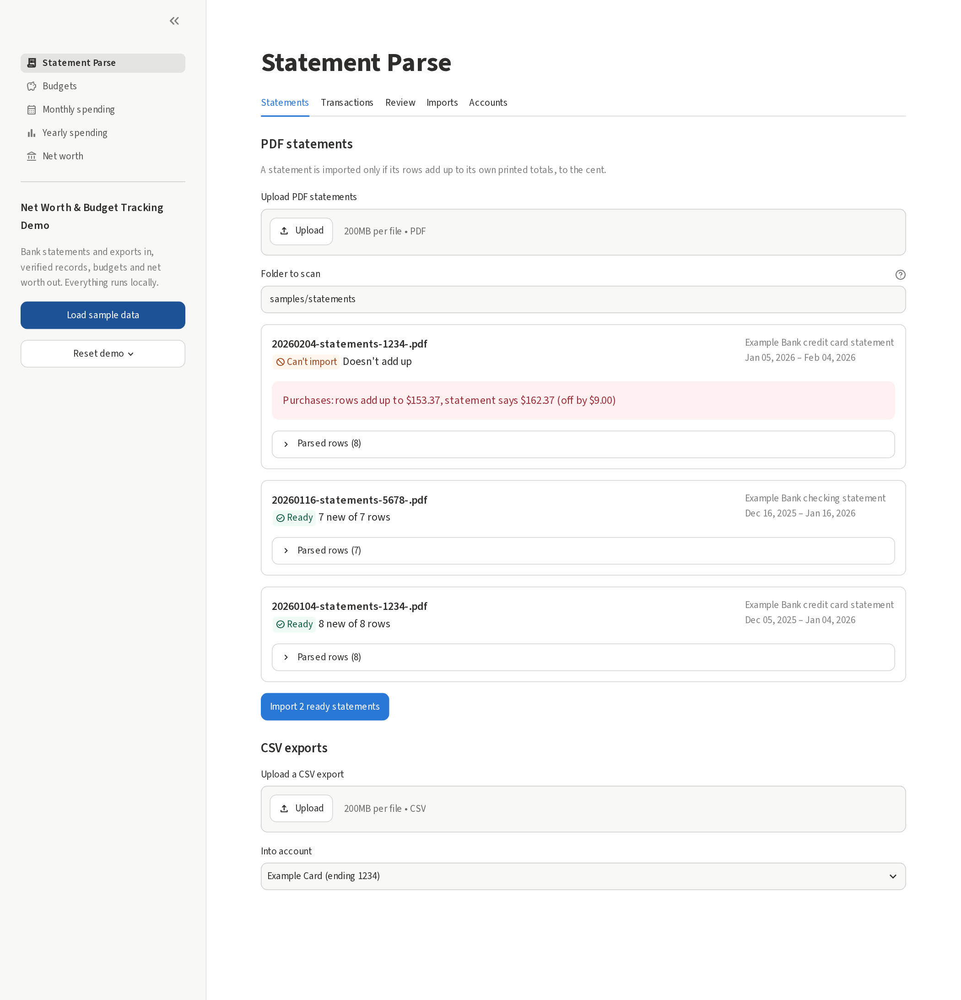
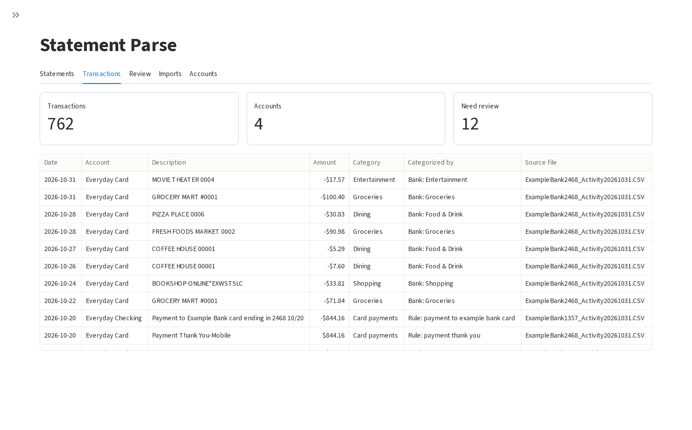
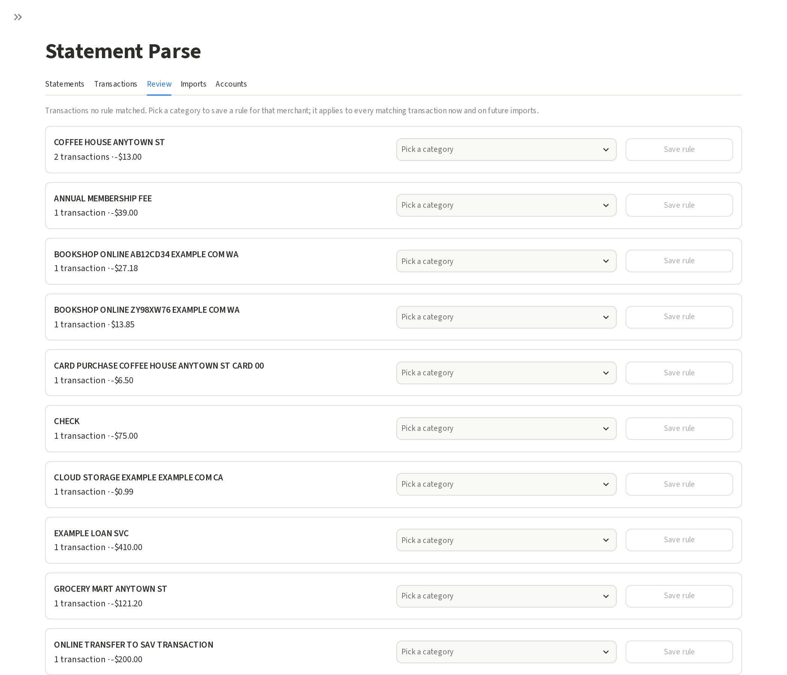
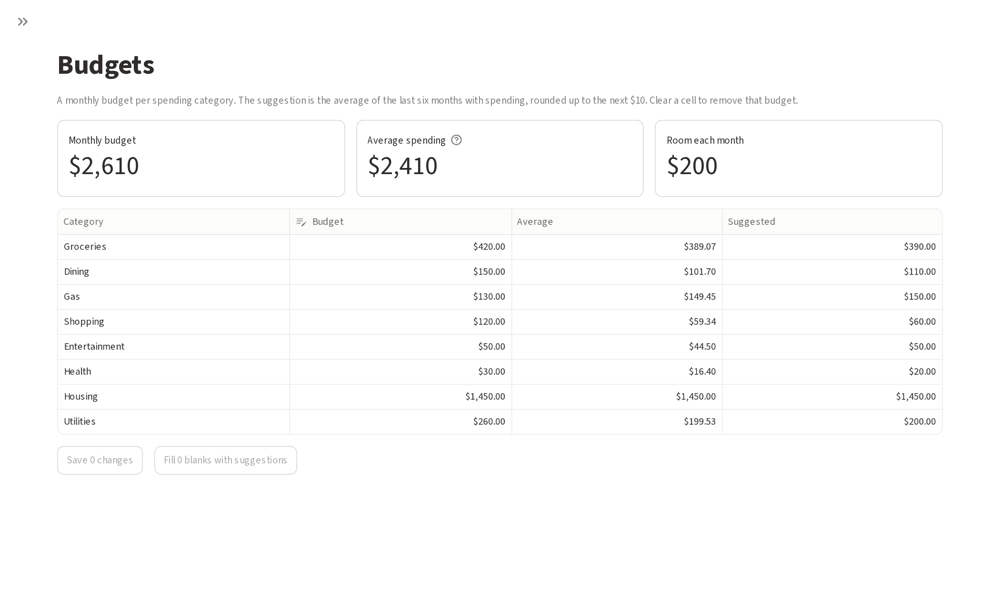
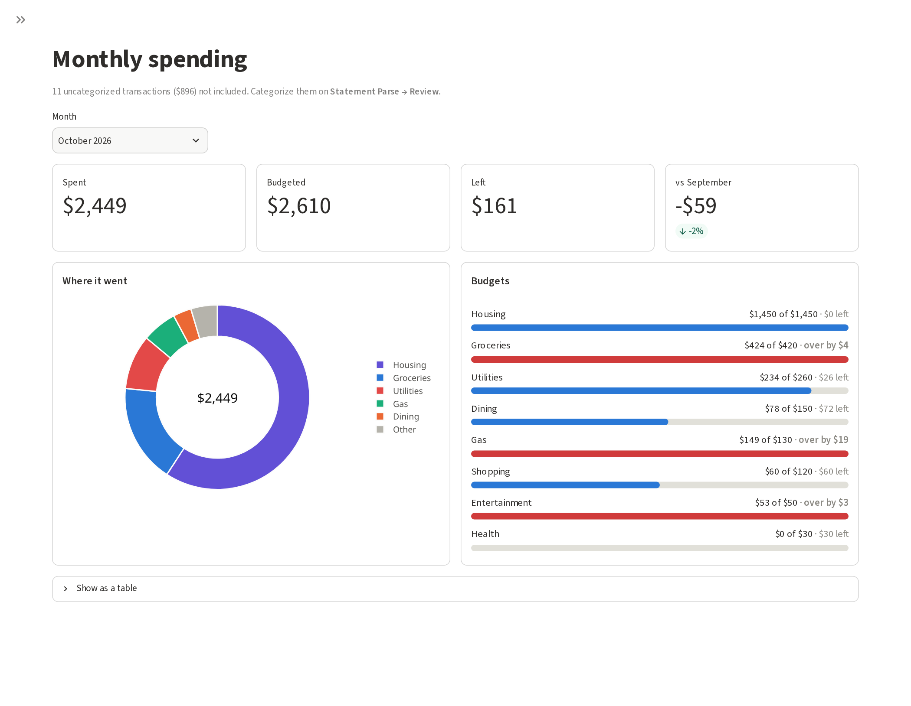
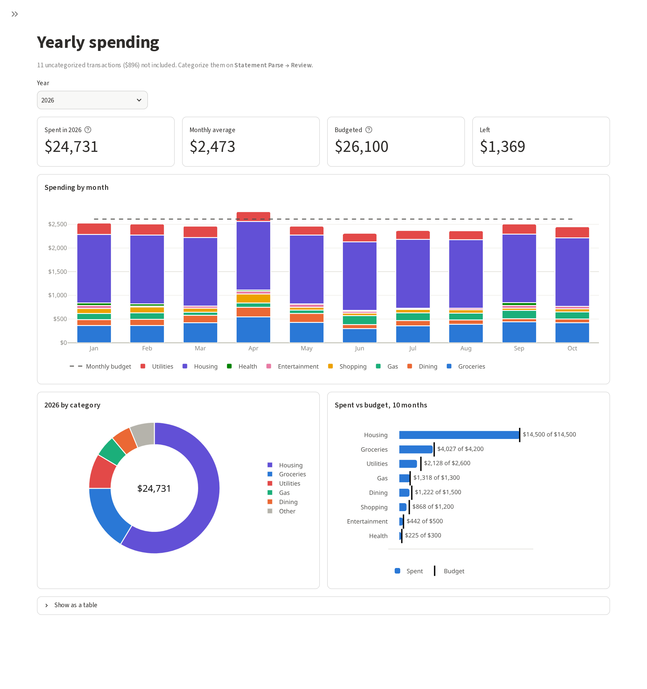
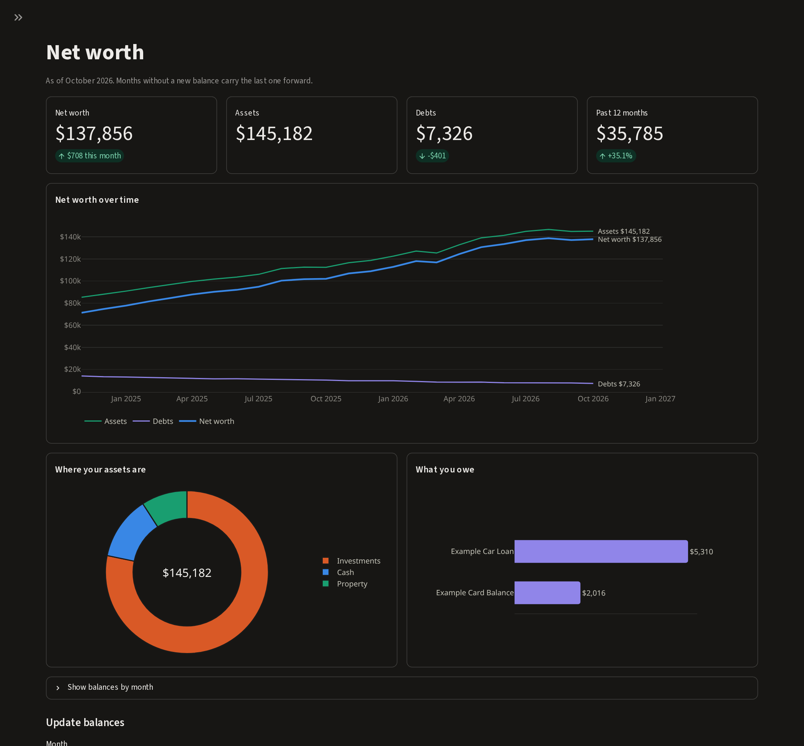

# Net Worth & Budget Tracking Demo

A simple local app for tracking spending, budgets and net worth. It reads bank PDF statements and CSV exports
and turns them into checked, de-duplicated and categorized transactions.

> **This is a demo with made-up data.** Every account, merchant, name and amount in this repository and in
> the screenshots below is invented. It runs entirely on your own machine.



## Features

### Statement import that checks its own work

A statement is imported only if its rows add up to its own printed totals, to the cent. Each file is marked
ready, already imported or can't import, with the reason. When one doesn't add up, the app shows which
section is off and by how much. One sample statement has a deliberately misread amount to show this.



### Transactions you can trace

Every transaction shows its category, the rule that set that category, and the file it came from. The same
purchase showing up in an overlapping CSV and PDF is stored only once.



### Review and rules

Merchants that no rule matched wait here. Pick a category to save a rule, and it applies right away and to
future imports.



### Budgets

A monthly budget for each category, with a suggestion based on recent average spending.



### Monthly spending

What you spent, what you budgeted and what's left, where the money went, and each budget's progress. A
category over its budget turns red and is labeled.



### Yearly spending

Spending by month stacked by category against the monthly budget, the year by category, and spending
against budget for each category.



### Net worth, in light or dark mode

Assets and debts over time, the change this month and over twelve months, where your assets are and what you
owe. Every chart works in light and dark mode, keeps each category's color across charts, and has a table
view.



## Run it

You need [uv](https://docs.astral.sh/uv/).

```sh
uv sync
uv run streamlit run app.py
```

Open http://localhost:8501 and click **Load sample data** in the sidebar. This adds invented accounts,
rules, budgets, two years of spending and two years of net worth balances. The sample PDF statements are
left on **Statement Parse** for you to import. **Reset demo** clears everything, after you confirm.

The data is kept in `demo.db`, a SQLite file next to `app.py`. To keep your own statements apart from the
demo, start it with `DEMO_DB=mine.db uv run streamlit run app.py`.

Your own statements stay on your computer:

- The app listens only on `127.0.0.1`. If it's made reachable from other computers, it scans only folders
  inside the project.
- Database files and uploaded statements are readable by their owner only.
- Statements, exports and databases (`*.pdf`, `*.csv`, `*.ofx`, `*.db` and the like) are git-ignored.

## How it checks the data

| Check | What it catches |
|-------|-----------------|
| **Reconcile to the cent.** Opening balance + activity must equal closing balance, and each section (purchases, payments, fees…) must match its printed subtotal. | A dropped row, a misread digit, or a row filed in the wrong section. |
| **Refuse, don't guess.** A statement that doesn't add up, or belongs to an unknown account, is reported with the reason and not imported. | Bad data reaching the database. |
| **De-duplicate by counting.** Rows match on account, date, amount and a loose description match. If a row appears n times in a file and m times already, only n − m are added. | Double counting from overlapping downloads, while keeping two real identical purchases. |
| **One record per file.** Each PDF is recorded by its SHA-256 hash, and each import is logged. | Importing the same file twice. Any import can be undone. |
| **Rules, then review.** Merchant rules and the bank's own categories run on import, and each row records which rule set it. | Wrong categories nobody can explain. |

Categories are spending, income or transfer, so paychecks and card payments never count as spending.

## Command line

The same parser is available as a command:

```sh
uv run python -m stmtrecon.samples                 # write the invented sample PDFs and CSVs to samples/
uv run stmtrecon accounts --name "Example Card" --type credit_card --last4 1234
uv run stmtrecon scan samples/statements           # dry run: what each file would do
uv run stmtrecon scan samples/statements --import
uv run stmtrecon list
```

## Project layout

```
app.py              web app entry point (Streamlit)
webui.py            shared web page code
views/              one file per page
src/stmtrecon/      parsing, reconciliation, storage, budgets, net worth, charts, CLI, sample data
tests/              pytest suite
docs/images/        screenshots for this README
```

It reads checking and credit card statements and CSV exports in one bank's layout, called "Example Bank" here.
Each layout is a small table of section names plus a row pattern, so adding another bank is a contained change.

## Tests

```sh
uv run pytest
```

The tests cover quirks of real PDF text extraction, reconciliation failures, de-duplication across
overlapping imports, categorizing rules, and a full round trip through a generated PDF.

Built with Python, Streamlit, Plotly, pdfplumber and SQLite.
